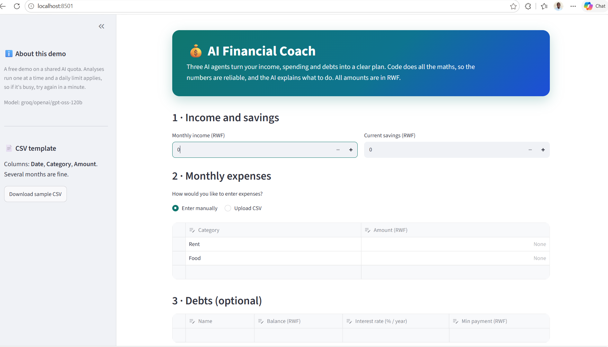
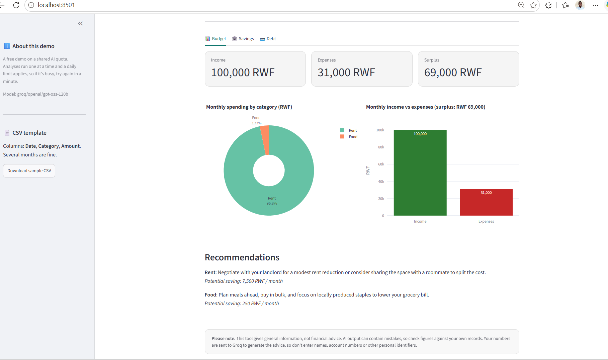
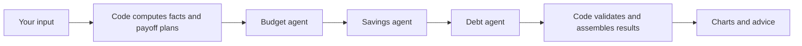

# 💰 AI Financial Coach

A multi-agent personal finance coach for Rwandan users (all amounts in RWF). Enter your income, expenses and debts, and three AI agents (budget, savings, debt) turn them into a practical plan with charts.

**▶ Live demo: https://personal-finance-ai-agent.onrender.com/**

> The demo runs on a free tier, so the first load after a quiet period can take about a minute to wake up. It uses a shared, free AI quota, so analyses run one at a time. If it's busy, try again in a minute.



## What it does

- **Budget analysis:** spending breakdown by category, income vs expenses, and recommendations for cutting costs.
- **Savings plan:** emergency fund target (6 months of expenses) and how to split your monthly surplus.
- **Debt payoff:** avalanche vs snowball comparison with months to debt-free and total interest.
- **Flexible input:** enter expenses manually or upload a CSV covering several months.



## How it works



The key design decision: **code owns every number, and the LLMs only write advice.** Totals, percentages, surplus and payoff schedules come from tested Python. The agents receive those verified facts and return structured advice, which is validated with Pydantic. Any figure an LLM tries to supply for itself is overwritten. If an agent fails, the app still shows the computed numbers along with a warning.

The three agents run in sequence using Google's Agent Development Kit (`SequentialAgent`) and share results through session state. Models are called through LiteLLM, so the provider can be swapped with one environment variable.

## Project structure

```
app.py                  Streamlit entrypoint
finance_coach/
  config.py             model and app settings
  guard.py              usage limits for the shared API key
  schemas.py            Pydantic models (RWF-aware validation)
  core/                 pure maths: facts.py, payoff.py (no LLM, no UI)
  data/                 CSV parsing and input validation
  agents/               prompts.py, advisor.py (ADK pipeline)
  ui/                   charts, result tabs, theme and CSS
evals/                  LLM evaluation harness: scenarios, checks, runner
scripts/                smoke test and helper scripts
tests/                  unit tests (no network, no LLM)
assets/                 sample CSV
```

## Run locally

```bash
git clone https://github.com/Yusuf-Olaniyi/personal_finance_ai_agent.git
cd YOUR_REPO
python -m venv .venv
.venv\Scripts\activate          # macOS/Linux: source .venv/bin/activate
pip install -r requirements-dev.txt
copy .env.example .env          # macOS/Linux: cp .env.example .env
# edit .env and add your GROQ_API_KEY
streamlit run app.py
```

Use Python 3.12. Newer versions may lack prebuilt wheels for some dependencies.

## Testing

| What | Command |
|---|---|
| Unit tests (fast, no network) | `pytest -v` |
| Provider smoke test | `python -m scripts.smoke_test` |
| LLM evals | `python -m evals.run_evals 2` |

Unit tests cover the schemas, payoff simulation (checked against hand-calculated amortization), CSV parsing, input validation and the eval checks themselves.

The **eval harness** runs five scenarios (healthy surplus, tight budget, deficit, no debts, heavy debt) several times each, because LLM output varies from run to run. It applies deterministic checks: recommended savings don't exceed the category spend, allocations stay within the real surplus, amounts are in RWF, and the advice agrees with the code-computed plans. Runs lost to provider rate limits are reported separately from quality failures. Reading the raw outputs found problems the checks didn't, and each one was fed back in as a new check.

## Design notes and limitations

- - **Shared-key deployment with guardrails:** one analysis at a time, a cooldown between runs, a daily cap and input limits protect the shared API quota. The key lives only in the host's environment variables, never in the code.
- Reasoning models can leak chain-of-thought into output. The pipeline requests low reasoning effort and validates every response against a schema.
- The debt simulator assumes fixed monthly payments and monthly compounding. It's a planning aid, not a lender's schedule.
- CSV averaging assumes full months of data, and refunds (negative amounts) are skipped.
- Your numbers are sent to the model provider (Groq). Don't enter names, account numbers or other identifiers.
- - The shared quota is small (free tier), so the demo handles roughly one analysis per minute across all visitors.

## Deployment

Deployed on Render (free tier) using `render.yaml`. Start command: `streamlit run app.py --server.port $PORT --server.address 0.0.0.0`. Set `PYTHON_VERSION` to a 3.12.x release and Deployed on Render (free tier) using `render.yaml`. Start command: `streamlit run app.py --server.port $PORT --server.address 0.0.0.0`. Set `PYTHON_VERSION` to a 3.12.x release and `GROQ_API_KEY` as a secret environment variable. Optional: `DEMO_DAILY_CAP` and `DEMO_COOLDOWN_SECONDS`.

## Disclaimer

This tool provides general information, not financial advice. AI output can contain mistakes, so verify figures against your own records.